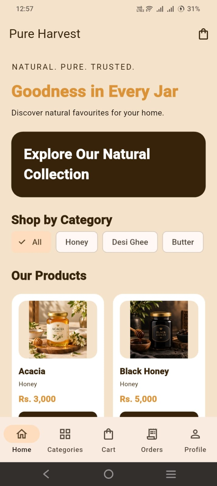
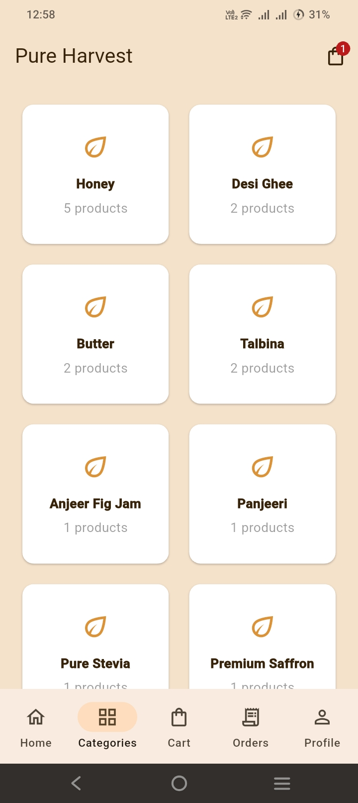
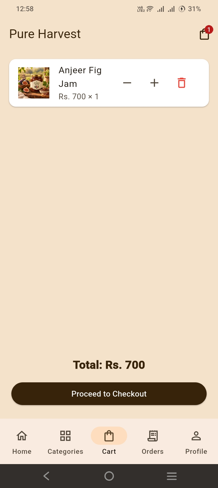
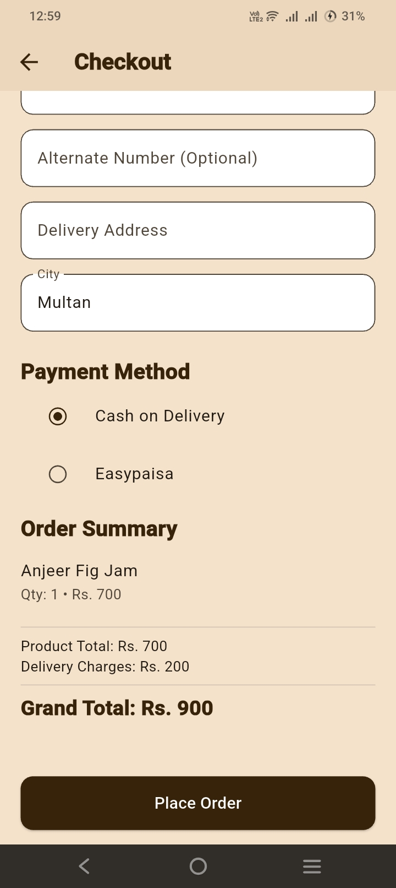
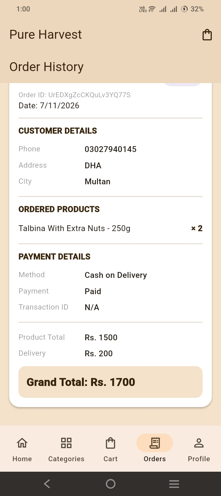

# Pure Harvest – Flutter App Portfolio

A modern cross-platform shopping application designed and developed using Flutter and Firebase.

## Project Overview

Pure Harvest provides customers with a smooth and convenient online shopping experience through a clean and user-friendly mobile interface.

## Key Features

- User Registration and Login
- Product Browsing and Categories
- Product Details
- Shopping Cart
- Checkout and Order Placement
- Cash on Delivery and Easypaisa options
- User Profile Management
- Order History

## Technologies

- Flutter
- Dart
- Firebase Authentication
- Cloud Firestore
- Shared Preferences

## App Screenshots

### Home Screen

### Categories

### Product Details

### Shopping Cart

### Order History

## Platforms

- Android
- iOS

## Developer

**Haram Javed**

Flutter Developer | Mobile Application Development

[GitHub Profile](https://github.com/haram-javed) | [LinkedIn](https://www.linkedin.com/in/haram-javed/)

*Designed and developed with Flutter and Firebase.*
